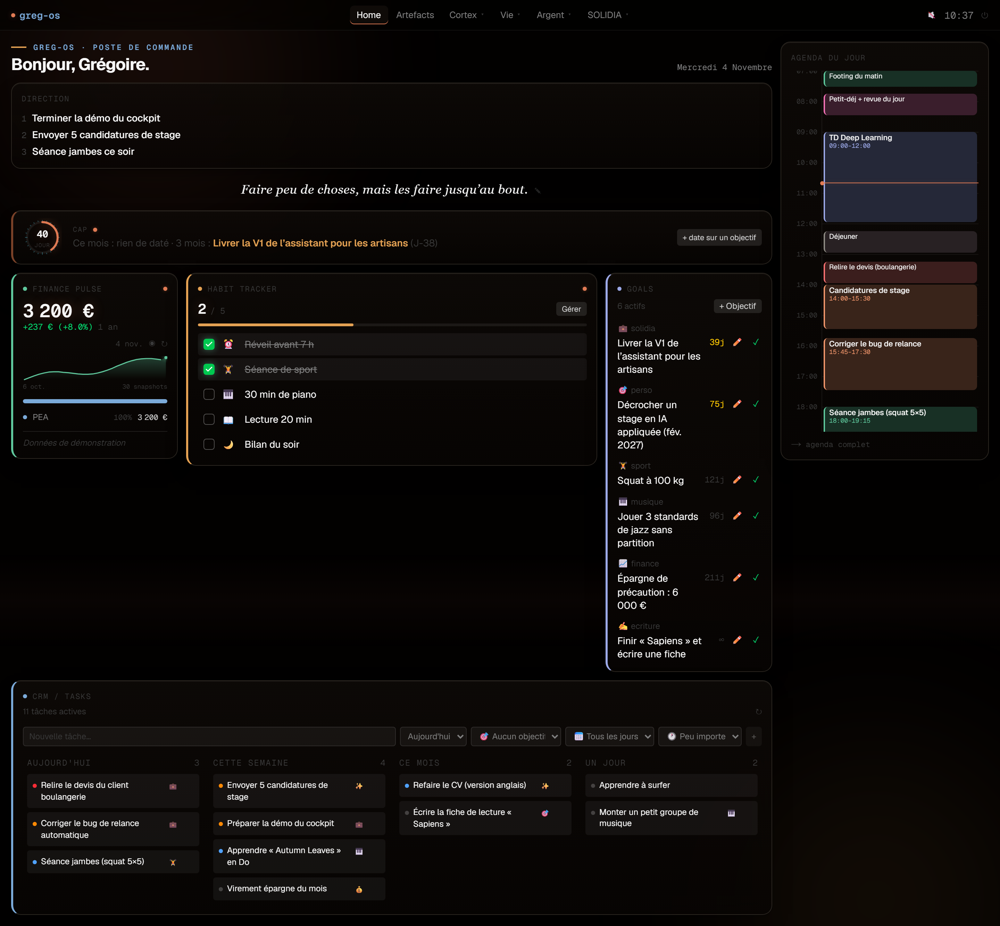
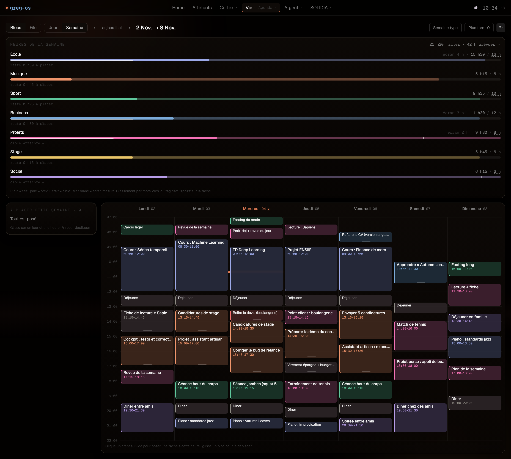
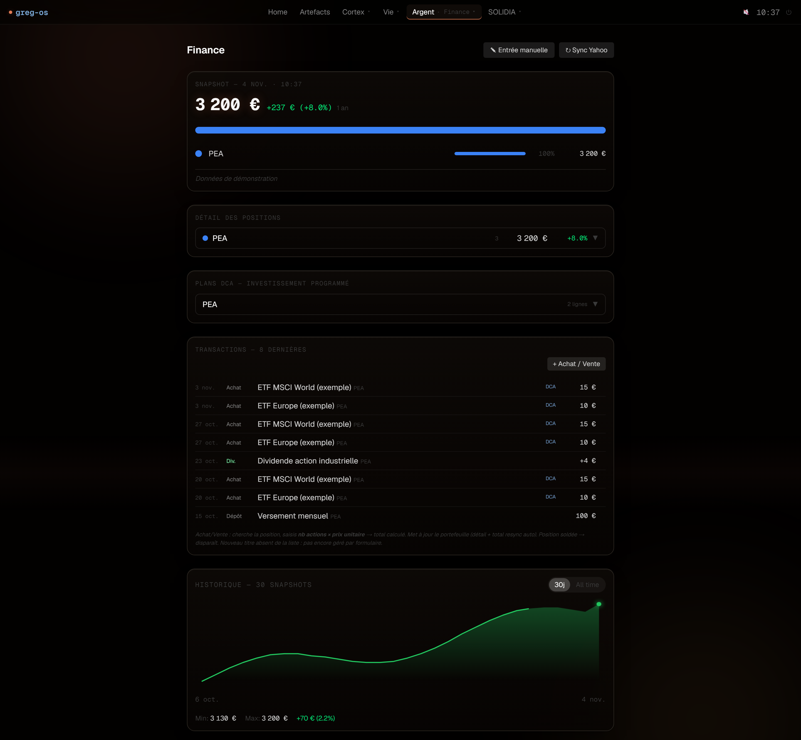
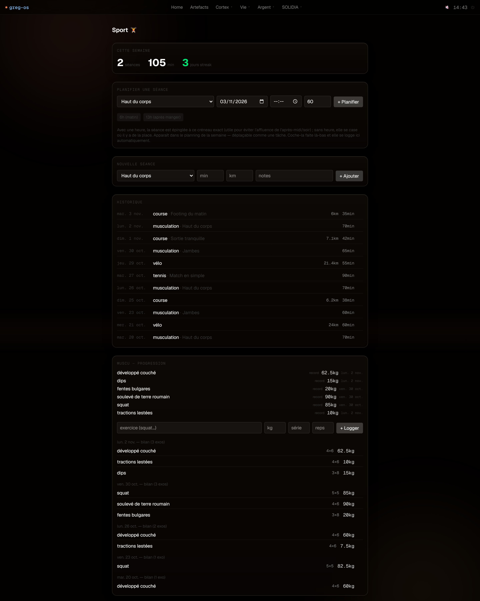
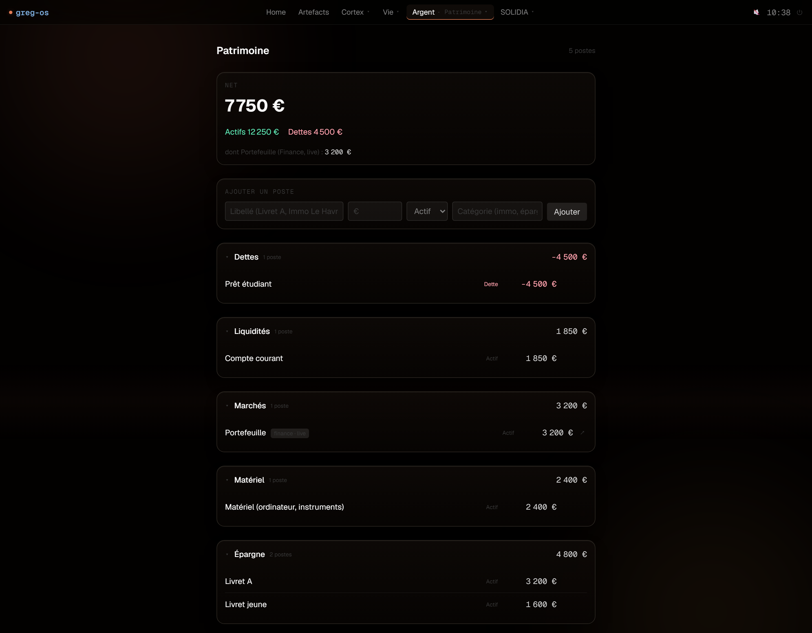
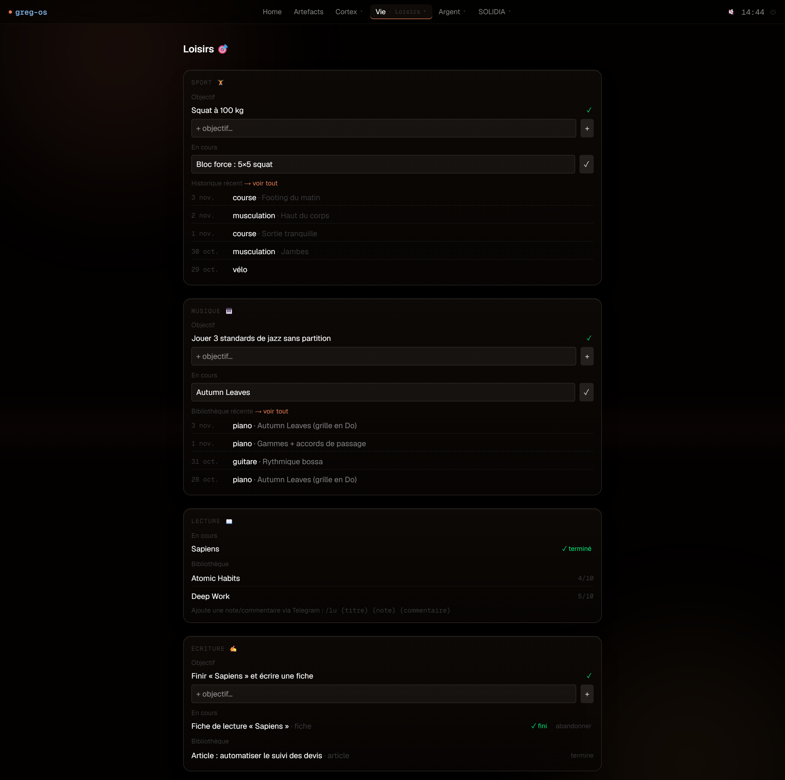

# Greg-OS: a personal operating system

A personal control panel I built to run my own week: priorities, goals, habits, tasks, a time-budgeted agenda, money, training and hobbies, all in one web app, with an AI agent on top.

> **All data in the screenshots is synthetic.** The interface is the real application, fed with made-up fixtures (a fictional student/founder profile). None of my personal data appears here. The UI is in French.
> The source code lives in a private repository. I'm happy to walk through it on request.

## What it does

| | |
|---|---|
| **Home** | Three hand-picked priorities, a life-direction line, a countdown to the next dated goal, habit tracker, goals, a task board sorted by horizon (today / week / month / someday), and the day's agenda. |
| **Agenda** | A weekly hour budget per category (school, music, sport, business, projects...), drag-and-drop time grid, a task queue, and a "typical week" template made of blocks rather than tasks. |
| **Finance** | Portfolio snapshots by pocket, per-position detail, recurring investment plans (DCA), transactions and a history curve. |
| **Net worth** | Assets and debts by category, with the live portfolio folded in. |
| **Sport** | Sessions, weekly stats and streak, plus strength progression (record per exercise, session recap). |
| **Hobbies** | Sport, music, reading and writing: one goal and one "in progress" item each, with a short history. |

## Screenshots

### Home

### Agenda: weekly hours budget and time grid

### Finance

### Sport

### Net worth

### Hobbies

## How it is built

- **Next.js 16 + React 19 + TypeScript**, Tailwind CSS 4, `@dnd-kit` for the drag-and-drop agenda.
- **Supabase (Postgres)** for storage; scheduled jobs on **Vercel Cron** (daily portfolio snapshot, weekly investment record, scheduled emails).
- **An LLM agent** (Anthropic SDK) reachable through a Telegram bot, with tools to read the agenda, tasks, finance and notes, and to create or complete tasks and log workouts. An AI news watch (daily fact, weekly review) is built too, currently paused.
- **Time tracking**: screen time is classified **locally** on my PC and only per-category minute totals are sent to the app. Window titles never leave the machine.
- **Security by default**: every page sits behind a session cookie (`iron-session`), constant-time secret comparison, login rate limiting, and a dedicated authentication helper for cron and webhook routes, covered by a test that fails if a route skips it.
- **Checks**: `npm run verify` runs the type checker and the unit tests on the pure logic (scheduling, hour budgets, week template, auth, parsing).

## Why I built it

I wanted one place that answers "what should I do now, and am I on track?", and I wanted to learn how to put an AI agent inside a real product I use every day, with the safeguards that requires: authenticated routes, secret handling and scheduled jobs that are safe to re-run.

---
Grégoire Hunout · [LinkedIn](https://www.linkedin.com/in/gr%C3%A9goire-hunout-b25bb9288/)
